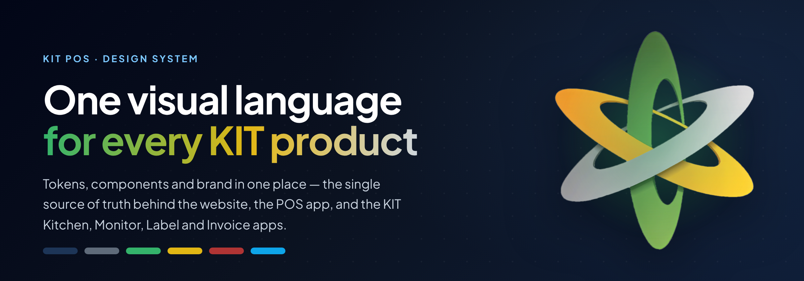
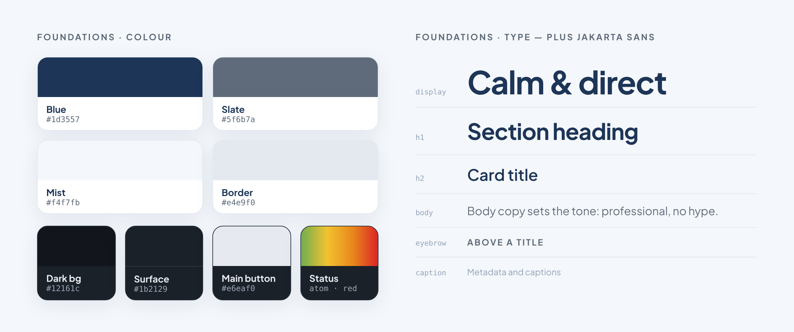
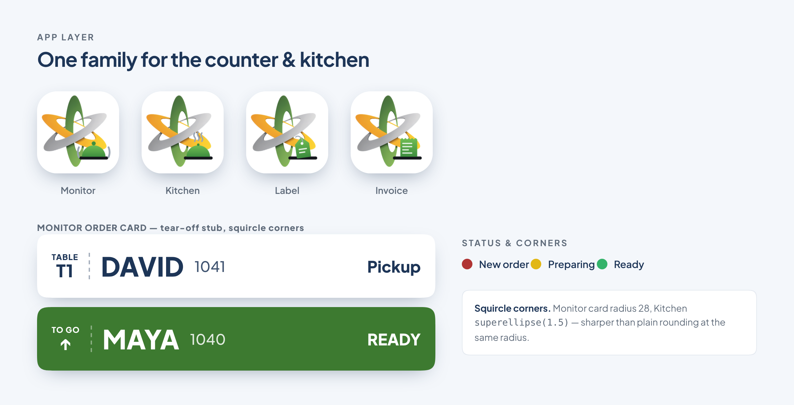

<div align="center">



**The single source of truth for every KIT POS product.**
One set of tokens, components and brand decisions — shared by the marketing
website, the POS app, and the KIT Kitchen, Monitor, Label and Invoice apps.

[Tokens](project/colors_and_type.css) · [Component previews](project/preview/) · [App layer](project/apps/README.md) · [Full docs](project/README.md)

</div>

---

## What's inside

```
project/
├── colors_and_type.css   ← Master token file: colours, typography, spacing, radii, shadows
├── preview/              ← HTML previews for every token and component
├── assets/               ← Brand logos, hardware photos, software screenshots
├── apps/                 ← App layer for Kitchen, Monitor, Label, Invoice, Waiter
└── ui_kits/
    ├── website/          ← React/JSX components for the marketing site
    └── pos-app/          ← HTML prototype of the POS cashier app
```

---

## Foundations



Everything starts from [`project/colors_and_type.css`](project/colors_and_type.css) — one
file of CSS custom properties for colour, typography, spacing, radii, shadows and motion.
Each token has a live example in [`project/preview/`](project/preview/).

- **Font** — Plus Jakarta Sans, across web and apps.
- **Primary** — Blue `#1d3557` for text, buttons and anchors; Slate `#5f6b7a` for secondary text.
- **Surfaces** — Light `#ffffff` / `#f4f7fb`, dark graphite `#12161c` / `#1b2129`; the dark-mode main button is near-white `#e6eaf0`, sky `#0ea5e9` is accent only. One palette for every app and the website.
- **No icon libraries** (Lucide only if needed) and **no emoji** in product UI or copy.
- **Tone** — calm, direct, professional. No hype language.

---

## App layer



The counter and kitchen apps share one look on top of the base tokens: the KIT atom
mark, one launcher-icon format, status colours, and squircle corners. The full
rationale — and the options that were turned down — lives in
[`project/apps/README.md`](project/apps/README.md).

- **The mark** — the KIT atom, with a soft sheen running along each orbit. Never redrawn ([`kit-mark.js`](project/apps/kit-mark.js)).
- **Icons** — the atom plus the app's object on a dark shelf: a bell (Monitor), a cloche (Kitchen), a price tag (Label), a receipt (Invoice).
- **Status** — the logo atom's colours: Preparing `#F2C230`, getting old `#E8891C`, Ready `#6FAE52` / `#3D7A30`; Late and New `#DC2626`.
- **Monitor order card** — a tear-off stub for where the order goes, and an R2 + O1 "ready" move ([`kit-ready.js`](project/apps/kit-ready.js)).
- **Corners** — squircles: Monitor card radius 28, Kitchen `superellipse(1.5)`.

---

## How to use in any product

### Web (Next.js / React)
Copy [`project/colors_and_type.css`](project/colors_and_type.css) into your project and import it in `globals.css`:
```css
@import './kit-pos-tokens.css';
```

### App layer (Kitchen / Monitor / Label / Invoice / Waiter)
Also load [`project/apps/kit-apps.css`](project/apps/kit-apps.css) on top of the base tokens.

### Mobile (React Native)
Convert the CSS variables from `colors_and_type.css` into a JS token object —
see `project/README.md → React Native / Mobile`.

### Asking an AI agent to build something
> "Use the KIT POS design system at https://github.com/walklikeaman/kit-pos-design-system —
> read `project/colors_and_type.css` for tokens, `project/apps/` for the app layer,
> and `project/preview/` for component examples."

---

## Products using this design system

| Product | Repository | Status |
|---|---|---|
| Marketing website | [walklikeaman/KIT-POS-Website](https://github.com/walklikeaman/KIT-POS-Website) | Live |
| POS app | Internal | In progress |
| Kitchen · Monitor · Label · Invoice | KIT apps | App layer |
| Mobile app | TBD | Planned |

---

## Updating tokens

1. Edit [`project/colors_and_type.css`](project/colors_and_type.css) (or `project/apps/kit-apps.css` for the app layer).
2. Update the relevant preview HTML in [`project/preview/`](project/preview/).
3. Commit: `update token: --kit-blue → #newvalue`.
4. Pull the latest in every product repo that references the file.

---

<div align="center">
<sub>README visuals are rendered from the design system's own tokens and assets — rebuild with <code>node assets/readme/source/build.cjs</code>.</sub>
</div>
